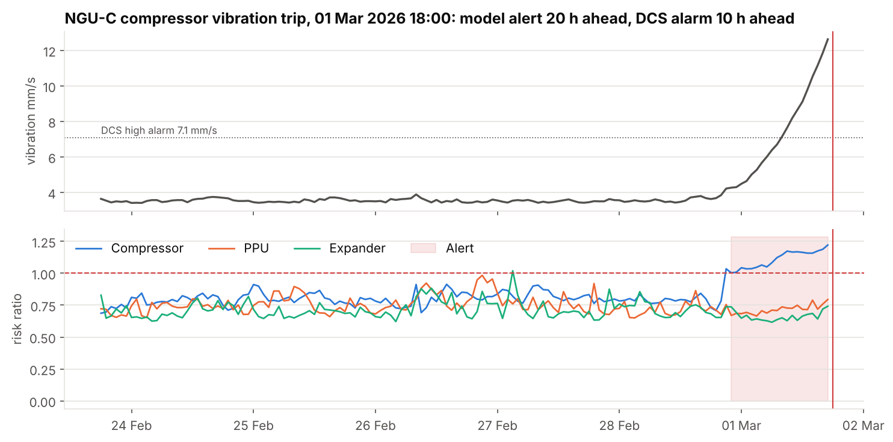
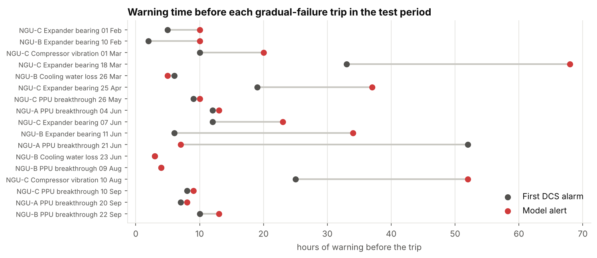
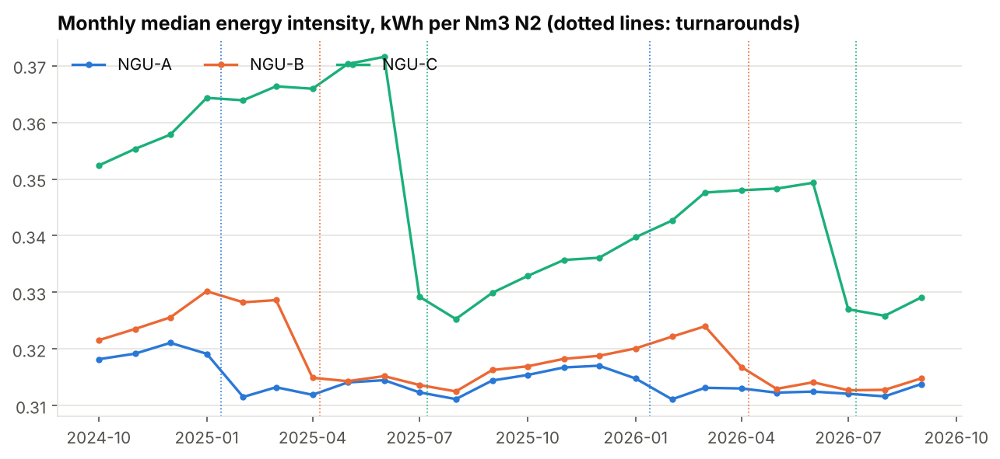
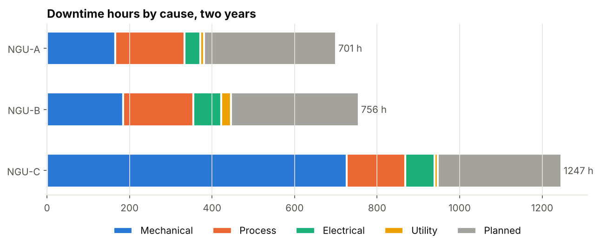

# Nitrogen plant operations intelligence

Two years of hourly operating data from the nitrogen generation unit of a fertiliser complex, worked through to answer two questions: which package burns the most energy per Nm3 of product, and can the process data warn the control room before a package trips?

The plant is fictional (NitroChem Process Industries Limited, Port Harcourt) and the data is synthetic. See the data disclaimer at the end.



## Problem

The nitrogen unit supplies purge, blanketing and seal gas to the ammonia and urea plants. When one of its three cryogenic packages trips, the backup liquid nitrogen (LIN) tank starts draining, road tankers get called in, and the package needs a cold restart with product vented until the O2 content is back on spec. When all three trip together, the header runs short and the downstream plants feel it.

Two questions:

1. Which package uses the most energy per Nm3 of N2, and why?
2. Can we catch the warning signs of an unplanned trip early enough to act?

## Approach

I modelled three cryogenic N2 packages (feed air compressor, molecular sieve pre-purification unit, cold box, turbo-expander) at hourly resolution from October 2024 to September 2026. That is 52,560 rows over 17 instrument tags per package, plus a maintenance log, an alarm journal, a shift log and the LIN tank balance.

Eight failure modes are built in. Four develop over hours or days: expander bearing wear, compressor vibration, PPU CO2 breakthrough and cooling water loss. Four are sudden: grid power dips, motor relay trips, compressor coupling failures and PPU switching valve failures. The data also carries the things that make real plant data awkward: historian gaps, monthly analyser calibrations that read as 0 and 8 ppm O2, nuisance alarms, seasonal cooling water temperature, and faults the crew caught before they tripped anything.

Then:

- Production and downtime analysis with full OEE (availability x performance x quality), MTBF and MTTR.
- Energy intensity (kWh per Nm3) by package, with a linear model that splits the worst package's gap into its causes.
- Anomaly detection with Isolation Forest: one model each for the compressor, the PPU and the expander/cold box, trained on healthy hours from the first year. The alert threshold is chosen on a four-month validation period, and the model is scored on eight months it never saw.
- A star schema for a four-page Power BI report, with an optional BigQuery load and SQL views.

## Main findings

1. NGU-C uses 11% more energy per Nm3 than NGU-A (0.348 against 0.314 kWh/Nm3). About two thirds of that gap is the compressor itself; the rest is intercooler fouling, which NGU-C picks up three times faster than NGU-A. At an assumed N150/kWh that costs about N39 million a year, and a mid-year intercooler clean would recover about N11 million of it.
2. On the eight-month test period the anomaly model caught all 17 gradual failures, and 18 of 29 unplanned trips in all (62%). Mechanical faults were flagged a median 28 hours ahead, 14 hours before the first DCS alarm. False alarms ran at 0.29 per package per month.
3. The other 12 test trips were sudden failures that leave no trace in process data. No model built on this data can catch them; they are a job for electrical protection and maintenance strategy. (The one sudden trip counted as caught was an unrelated alert that happened to fall in the window.)
4. Energy intensity climbs before mechanical trips, 8 to 12% in the last 12 hours, but only 3 to 4% a day out. It confirms a developing fault late; it does not give early warning on its own.
5. Half of all alarm activations were not followed by a trip. NGU-C's aftercooler high-temperature alarm (TI-303) stands in alarm through most of the dry season. It is a nuisance alarm, and also the first clue to NGU-C's fouling problem.
6. The N2 header ran short for 52 hours in two years, every one of them during a plant-wide power dip. The limit was vaporiser capacity (2,500 Nm3/h against about 2,700 Nm3/h demand), not LIN stock.







## Notebooks

| Notebook | What it does |
|---|---|
| [01_data_generation](notebooks/01_data_generation.ipynb) | Builds and checks the dataset, shows two fault signatures, optional BigQuery load |
| [02_eda_production](notebooks/02_eda_production.ipynb) | Data quality, production, downtime Pareto, OEE, MTBF, alarm noise, LIN backup |
| [03_energy_intensity](notebooks/03_energy_intensity.ipynb) | Energy per Nm3 by package, fouling and weather effects, naira cost, pre-trip behaviour |
| [04_anomaly_detection](notebooks/04_anomaly_detection.ipynb) | Isolation Forest per equipment group, threshold selection, test-period evaluation |
| [05_dashboard_data](notebooks/05_dashboard_data.ipynb) | Star-schema tables for Power BI, reconciliation checks |

## Repository layout

```
src/
  generate_nitrogen_plant_data.py   data generator (the full simulation, seed 42)
  load_to_bigquery.py               loads a folder of CSVs into a BigQuery dataset
  plant_style.py                    shared paths, colours and chart style
notebooks/                          the five notebooks, run in order
data/raw/                           generator output
data/processed/                     dashboard tables and model scores
sql/                                BigQuery views: monthly KPIs, downtime Pareto, high-risk days, energy gap
docs/
  powerbi_build_guide.md            model, DAX measures and page layouts for the report
  powerbi_theme.json                report colours
  data_dictionary.md                every table and tag
reports/figures/                    charts saved by the notebooks
```

## How to run

```bash
pip install -r requirements.txt
python src/generate_nitrogen_plant_data.py      # writes data/raw, about 5 seconds
jupyter notebook notebooks/                      # run 01 to 05 in order
```

To load to BigQuery, install `google-cloud-bigquery` and `pyarrow`, run `gcloud auth application-default login`, then either set `LOAD_TO_BIGQUERY = True` in notebooks 01 and 05, or run:

```bash
python src/load_to_bigquery.py --project your-gcp-project-id --dataset nitrochem_ngu --folder data/processed
```

The views in `sql/` use the same dataset name.

## Power BI dashboard

Four pages, built from `data/processed/`:

1. Overview: production, downtime, OEE and energy intensity cards for the selected month, OEE trend, LIN tank level.
2. Downtime analysis: hours by package and cause, 24-month trend, failure mode Pareto, MTBF and MTTR.
3. Energy efficiency: energy intensity trend, running hours against energy, gap to NGU-A in naira with an adjustable power cost.
4. Anomaly alerts: daily risk score by package, high-risk days, alert list with outcomes.

The model, DAX measures and layout are in [docs/powerbi_build_guide.md](docs/powerbi_build_guide.md).

## Tools

Python (pandas, NumPy, scikit-learn, matplotlib), Jupyter, BigQuery, SQL, Power BI, GitHub.

## Limitations

- The data is synthetic. Fault signatures here are cleaner than in a real plant, where instrument drift, setpoint changes and overlapping faults blur them. Read the detection results as a demonstration of the method, not a performance claim for a real unit.
- The test period holds 17 gradual failures. Catching all 17 is a good result on a small sample, not proof the model never misses.
- Hourly averages hide fast transients. A real deployment would use 1-minute historian data for vibration and analyser signals.
- The power cost (N150/kWh) is an assumption for illustration. The Power BI page and notebook 03 let you change it.

## Data disclaimer

All data in this project is synthetically generated. No proprietary or confidential operational data from any employer or facility was used. Operating ranges are typical published values for small cryogenic nitrogen generators, instrument tags follow the generic ISA-5.1 convention, and the fault scenarios are failure modes described in open process engineering literature. The approach of injecting known faults at known times, so a detection method can be scored against ground truth, follows the Tennessee Eastman Process benchmark (Downs, J.J. and Vogel, E.F., 1993, "A plant-wide industrial process control problem", Computers and Chemical Engineering, 17(3), 245-255).

The data generation script is in this repository in full. Run it with seed 42 and you get exactly the same data.
